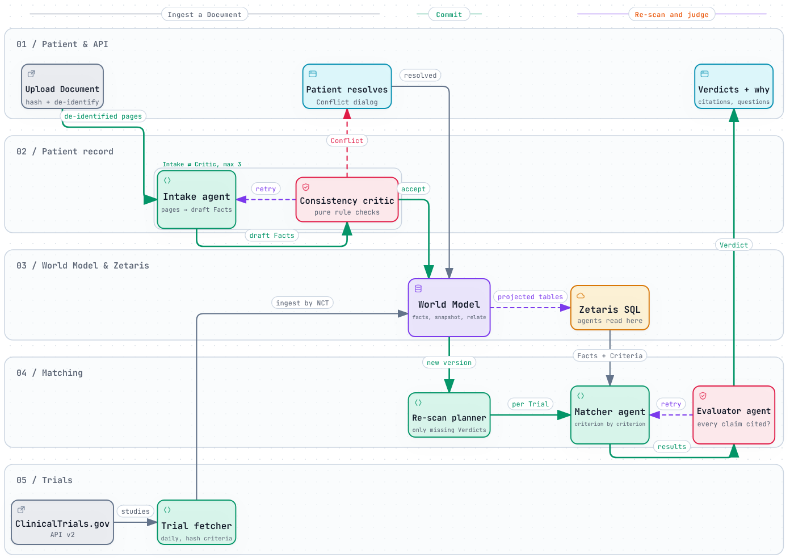

# Developer guide

How the code is laid out, how the agents work together, and the rules that keep it coherent. For the design rationale read [docs/architecture.md](docs/architecture.md); for vocabulary, [GLOSSARY.md](GLOSSARY.md).

> Status: scaffold. Signatures, types and pseudocode are in place; bodies raise `NotImplementedError`. Treat the signatures as the contract. If an implementation needs something they don't allow, raise it with the team before working around it.

## Agent workflow



Interactive version (dark/light, click a box to open its source lines): open [docs/diagrams/agent-workflow.html](docs/diagrams/agent-workflow.html) in a browser after cloning. It shows the designed flow traced from the scaffold's signatures and pseudocode.

**Reading it:**

1. **Intake questionnaire.** The Respondent (the patient, or family on their behalf) answers plain-language questions first. A completed questionnaire is itself a Document ([ADR 0003](docs/adr/0003-intake-questionnaire-is-a-document.md)): structured answers map to Patient-reported Facts in code, free-text answers go through Intake. On its own it creates Profile v1, so matching starts before any upload. Postcode is kept as a search preference, never a Fact.
2. **Upload** (optional, any time). `record.register_document` hashes the file, splits it into pages and de-identifies them before any model sees the text. Each upload creates its own Profile version.
3. **Intake ⇄ Critic** (max 3 attempts). Intake drafts Facts with page citations; the critic runs pure rule checks. Fixable findings go back to Intake. A Conflict with the existing record goes to the patient instead, because re-reading the same Document can't change what it says.
4. **Commit.** Accepted Facts are written through the **World Model** (`assert_fact` per Fact, `snapshot` for the Profile version). The engine projects them into Postgres in the same transaction; Zetaris reads those tables.
5. **Re-scan.** For a new Profile version, judge every active Trial that lacks a Verdict for (NCT, eligibility hash, version). Running it twice does nothing the second time.
6. **Matcher ⇄ Evaluator** (max 3 attempts). The Matcher judges each Criterion against the patient's Facts, read through Zetaris, and sees each site as "name, status, km": code computes the distances from the postcode, which no model ever sees. The Evaluator rejects any claim without a valid citation. After 3 attempts, unsupported claims become `unknown`: a Doctor question when it needs clinical records, a Respondent question when it turns on something the Respondent could clarify (a vague date, a medicine name). An uncited "met" is never stored.
7. **Verdicts + why.** Verdicts ranked by outcome, then nearest recruiting site (distance never changes a Verdict), with Citations back to the Document page, what changed since the last version, and the causal trace of how the system decided.
8. **Trials** arrive separately: the fetcher pulls ClinicalTrials.gov through Zetaris and records them with World Model `ingest`, keyed by NCT ID. Only new or changed Trials trigger work.

## Folder structure

```
.
├── README.md                     project overview, sponsor tech, setup
├── DEVELOPER.md                  this file
├── GLOSSARY.md                   agreed domain terms (use these names in code and UI)
├── .env.example                  settings template; copy to .env (never commit .env)
├── .gitignore                    secrets, data/raw/, build output, .archify/
├── docker-compose.yml            our Postgres on port 5433 (Zetaris runs from its own bundle)
│
├── backend/
│   ├── pyproject.toml            dependencies; pytest config
│   ├── app/
│   │   ├── main.py               FastAPI app; builds one Ctx at startup
│   │   ├── config.py             Settings from .env: URLs, tokens, loop bounds, lane models
│   │   ├── ctx.py                the dependency bundle every facade takes
│   │   │
│   │   ├── record/               PATIENT RECORD: Documents, Facts, Profile versions, Conflicts
│   │   │   ├── __init__.py       public API: register_document, ingest, confirm, versions, diff, ...
│   │   │   ├── types.py          Document, Page, DraftFact, Fact, ProfileVersion, Finding, Conflict
│   │   │   ├── pdf.py            bytes → pages of text and tables
│   │   │   ├── deidentify.py     strips names, addresses, record numbers before any model call
│   │   │   ├── intake.py         Intake agent (fast lane): pages → draft Facts
│   │   │   ├── critic.py         Consistency critic: pure rule checks, retryable vs Conflict
│   │   │   ├── loop.py           Intake ⇄ Critic state machine; commit through the World Model
│   │   │   └── repo.py           SQL reads; writes only documents and pages
│   │   │
│   │   ├── trials/               TRIALS: ClinicalTrials.gov, eligibility hash, Criteria
│   │   │   ├── __init__.py       public API: sync, trial, active_trials, criteria
│   │   │   ├── ctgov.py          fetch via Zetaris REST table, HTTP fallback
│   │   │   ├── criteria.py       eligibility text → Criteria (deterministic split, model fallback)
│   │   │   └── repo.py           SQL reads
│   │   │
│   │   ├── matching/             MATCHING: Criterion results, Verdicts, Doctor questions, Re-scan
│   │   │   ├── __init__.py       public API: rescan, verdict, verdicts_for_version, change_between, ...
│   │   │   ├── types.py          CriterionResult, Citation, ValidatedResults, Verdict, ...
│   │   │   ├── matcher.py        Matcher agent (deep lane)
│   │   │   ├── evaluator.py      Evaluator: structure check, then judge-lane support check
│   │   │   ├── verdict.py        pure rules: outcome from results, questions from unknowns
│   │   │   ├── loop.py           Matcher ⇄ Evaluator state machine; Re-scan plan and run
│   │   │   └── repo.py           SQL reads
│   │   │
│   │   ├── worldmodel/           METERLESS WORLD MODEL (our Python implementation)
│   │   │   ├── __init__.py       public API: WorldModel, Provenance, timeline, ...
│   │   │   ├── engine.py         upsert_entity, assert_fact, relate, snapshot, ingest, audit
│   │   │   ├── stable_ids.py     deterministic ids (normalize_name, fact_id, event_id)
│   │   │   ├── resolve.py        merge bands: ≥0.85 auto-merge, 0.82–0.85 review
│   │   │   ├── store.py          event log: in-memory (tests) or Postgres (app)
│   │   │   ├── projector.py      engine events → the tables Zetaris reads
│   │   │   └── timeline.py       the ONLY mapping from domain operations to engine calls
│   │   │
│   │   ├── trace/                HOW THE SYSTEM REASONED
│   │   │   ├── __init__.py       runs, append, causal tree, model-call log
│   │   │   ├── events.py         the single list of trace event kinds
│   │   │   └── state.py          pure reducers: events → run state
│   │   │
│   │   ├── llm/                  AI CONNECTION
│   │   │   ├── __init__.py       complete(lane, ...) — the only way to call a model
│   │   │   ├── nightshift.py     Meterless Nightshift client + LangChain chat models; FakeLLM for tests
│   │   │   └── media.py          image, speech, music, video on a Meterless job
│   │   │
│   │   ├── sql/                  STORAGE SPLIT (ADR 0001)
│   │   │   ├── reader.py         PgReader (UI) and ZetarisReader (agents), same queries
│   │   │   └── writer.py         Postgres transactions
│   │   │
│   │   └── api/                  thin HTTP routes under /api (see docs/api.md)
│   │       └── documents.py · patients.py · runs.py · trials.py · verdicts.py · health.py · schemas.py
│   │
│   └── tests/
│       ├── test_boundaries.py    fails on imports of another module's internals
│       └── worldmodel/
│           └── test_conformance.py   Meterless's 8 conformance checks, ported
│
├── db/
│   ├── schema.sql                Postgres tables, with the owner of each one noted at the top
│   ├── migrations/               additive scripts for a database created from an older schema.sql
│   └── zetaris_register.sql      registers our Postgres and ClinicalTrials.gov in Zetaris (to finish)
│
├── docs/
│   ├── architecture.md           design, synthesis decision, tradeoffs, open risks
│   ├── api.md                    HTTP endpoints and response shapes
│   ├── adr/                      decision records (0001 storage split, 0002 append-only + versioned Verdicts, 0003 questionnaire is a Document)
│   ├── diagrams/                 agent-workflow.html / .png and its source .workflow.json
│   └── setup/                    meterless-provider-prompt.md (Nightshift wiring, not yet applied)
│
├── frontend/                     Next.js app (not created yet; see its README for pages)
├── data/
│   ├── demo/                     de-identified demo Documents (committed)
│   ├── raw/                      real Documents (gitignored; never commit)
│   └── trials_snapshot/          saved trial results for an offline demo
└── scripts/                      seed_demo, sync_trials, rebuild_projections (to write)
```

## Rules that keep it coherent

- **Import a module's facade, never its internals.** Write `from app.record import ingest`, not `from app.record.loop import run_ingest`. `tests/test_boundaries.py` enforces this.
- **One writer per table.** The World Model writes facts, Profile versions, trials, criteria and verdicts (via `worldmodel/timeline.py`). `record/repo.py` writes documents and pages. `app.trace` writes trace events and model calls. The owner of each table is listed at the top of `db/schema.sql`.
- **Agents read through Zetaris.** Use `ctx.agent_reader`. The UI routes use `ctx.ui_reader` (Postgres). Both run the same query functions.
- **Agents are built with LangChain.** An agent takes its model from `ctx.llm.chat_model(lane)`, a `ChatOpenAI` already pointed at Nightshift with the required headers and pinned to the lane's model. Never construct a chat model or OpenAI client anywhere else.
- **One-shot structured calls go through `app.llm.complete`** with a lane (`fast`, `deep`, `judge`). It records which model answered. Which model serves each lane is a setting (`LANE_MODELS`); all three default to `nvidia/nemotron-3.5-lightning-30b-a3b`.
- **Loops are bounded.** Each loop has a pure `decide()` with a closed set of outcomes and a max-attempt setting. Exhaustion is an outcome, not an exception.
- **No model sees raw patient text.** De-identification runs in `register_document`. Real documents live only in `data/raw/`.
- **Trace every step.** Append a trace event for each loop step so the Why page can show it.
- **Names come from GLOSSARY.md.** If you need a new term, add it there first.

## Getting started

```bash
cp .env.example .env              # fill in Zetaris API key and Nightshift token
docker compose up -d              # our Postgres with db/schema.sql (first start only)
# A Postgres volume made from an older schema.sql: run each db/migrations/*.sql once, in order (see its header)
cd backend
python3 -m venv .venv && .venv/bin/pip install -e ".[dev]"
.venv/bin/pytest                  # boundary test passes; conformance fails until the engine exists
.venv/bin/uvicorn app.main:app --reload
```

Zetaris and Meterless Nightshift run on your own machine (hackathon rule); install them from the Participant Setup Guide first.

## Check the LLM connection yourself

Nightshift must be running (default `http://127.0.0.1:8088`), and `.env` at the repo root needs `METERLESS_RUNTIME_TOKEN`. Run these from the repo root. None of them prints the token.

```bash
backend/.venv/bin/python scripts/meterless.py status       # online | unauthorized | offline, plus whether each lane's model is listed
backend/.venv/bin/python scripts/meterless.py detect       # Auto Detect: ports 8088, 8090, 8787, 11434
backend/.venv/bin/python scripts/meterless.py chat "Reply with exactly: pong"   # plain text on METERLESS_MODEL
backend/.venv/bin/python scripts/meterless.py lane fast    # JSON reply through the fast lane's LangChain model (also: deep, judge)
backend/.venv/bin/python scripts/meterless.py media        # which of image, speech, music, video this runtime can make, and why not
backend/.venv/bin/python scripts/meterless.py illustrate "A calm watercolour of a hospital garden" --privacy cloud-ok
backend/.venv/bin/pytest tests/llm                         # run from backend/: provider and media tests, mocked runtime, no network
```

What good looks like:

- `status` prints `online` and `listed` for every lane. `unauthorized` means the token is wrong: copy it again from `<stateDir>/proxy-token`. `offline` means nothing answered `GET /v1/models`.
- `chat` prints `pong`. `lane fast` prints `requested … answered nvidia/nemotron-3.5-lightning-30b-a3b`; that line is what proves the Nemotron lane served the call.
- `illustrate` prints `stored data/media/<job>/<seq>-<file>.png` (gitignored). On a runtime without a media engine it prints `Images unavailable: <reason>` and exits 2. The Nightshift web build has no media engine, so seat an image lane (still-sdcpp and weights) first.
- Media source jobs use `MEDIA_PRIVACY` (default `local-only`). That floor is never widened, so on a box whose only local lane is the in-browser device model, a `local-only` job waits until the Nightshift page is open.

## Ingest Australian trials

Postgres must be up (`docker compose up -d`). From the repo root:

```bash
backend/.venv/bin/python scripts/ingest_trials.py --live          # page the live ClinicalTrials.gov v2 API, Australia only
backend/.venv/bin/python scripts/ingest_trials.py --pages <dir>   # or: saved GET /api/v2/studies pages, one per file
backend/.venv/bin/pytest tests/trials                             # run from backend/: recorded pages, no network
```

`--live` requests `GET /api/v2/studies?query.locn=Australia&pageSize=1000` and follows `nextPageToken` to the last page (about 13 pages for 12,600 studies), spacing requests to 40 a minute under the API's limit of about 50 and retrying timeouts, 429s and 5xx with back-off. It keeps only studies with an Australian Trial site and drops withdrawn ones (ADR 0004). It prints `N Trials from http: … new, … changed, … unchanged`; a second run reports everything unchanged. If a page still fails after the retries, the run stops and records nothing, so just run it again. It makes no model call and starts no Re-scan.

## Where to start

1. `backend/app/worldmodel/` until `tests/worldmodel/test_conformance.py` passes 8/8. Everything else writes through it.
2. `record/critic.py`, `record/loop.py: decide`, `matching/loop.py: decide` and `matching/verdict.py`: pure functions, easy to test.
3. `sql/reader.py` against a running Zetaris (check how Lightning SQL handles our queries).
4. ~~`llm/nightshift.py`~~ done: see [Check the LLM connection yourself](#check-the-llm-connection-yourself).

## Updating the workflow diagram

The diagram is generated with [archify](https://github.com/tt-a1i/archify) (`npx skills add tt-a1i/archify -g`) from `docs/diagrams/agent-workflow.workflow.json`, whose `sources` point at the code lines behind each box. After changing the flow, update that file and run:

```bash
node <archify>/bin/archify.mjs finalize workflow docs/diagrams/agent-workflow.workflow.json \
  docs/diagrams/agent-workflow.html --repo-root . --quality showcase --json
```

Update `meta.repository.revision` to the commit the sources refer to, and re-export the PNG from the viewer's Export menu.
